# Manual de uso de v-note

v-note es un cuaderno de notas personal, de un solo usuario, que guarda todo en tu equipo y funciona sin internet. Se puede usar en el navegador (versión web, instalable como PWA) o como aplicación de escritorio (Linux, Windows y macOS). La única conexión a internet que usa es la copia de seguridad opcional a un repositorio privado de GitHub.

> Las capturas se generaron con la versión web. La de escritorio se ve igual y añade las funciones marcadas con 🖥️.
> El nombre del producto puede cambiar: vive en `brand.config.json`.

## Contenido

1. [Primeros pasos](#1-primeros-pasos)
2. [Espacios de trabajo](#2-espacios-de-trabajo)
3. [Páginas y barra lateral](#3-páginas-y-barra-lateral)
4. [El editor de bloques](#4-el-editor-de-bloques)
5. [Buscar y la paleta de comandos](#5-buscar-y-la-paleta-de-comandos)
6. [Enlaces entre páginas y grafo](#6-enlaces-entre-páginas-y-grafo)
7. [Bases de datos](#7-bases-de-datos)
8. [Tableros kanban](#8-tableros-kanban)
9. [Tareas, recordatorios y agenda](#9-tareas-recordatorios-y-agenda)
10. [Diagramas y organizadores gráficos](#10-diagramas-y-organizadores-gráficos)
11. [Captura rápida](#11-captura-rápida)
12. [Importar](#12-importar)
13. [Exportar a HTML y PDF](#13-exportar-a-html-y-pdf)
14. [Respaldo en GitHub y restauración](#14-respaldo-en-github-y-restauración)
15. [Ajustes: tema, idioma y atajos](#15-ajustes-tema-idioma-y-atajos)
16. [Versión de escritorio](#16-versión-de-escritorio)
17. [Preguntas frecuentes](#17-preguntas-frecuentes)

---

## 1. Primeros pasos

**Abrir la aplicación (para desarrollo o prueba):**

```bash
# Versión web: abre http://localhost:1440
cd apps/web && bun run dev

# Versión de escritorio
cd apps/desktop && bun run tauri dev
```

La primera vez ves la pantalla de **Espacios de trabajo**. Escribe un nombre (por ejemplo «Personal») y pulsa **Crear espacio**.

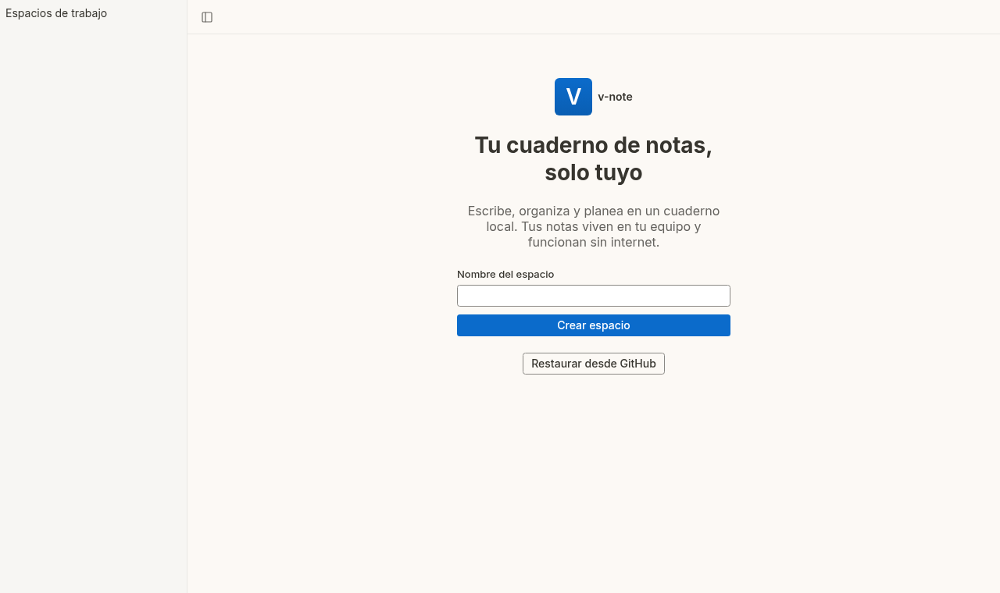

Al crearlo entras al espacio. A la izquierda está la **barra lateral** (árbol de páginas y accesos) y a la derecha el área de la página.

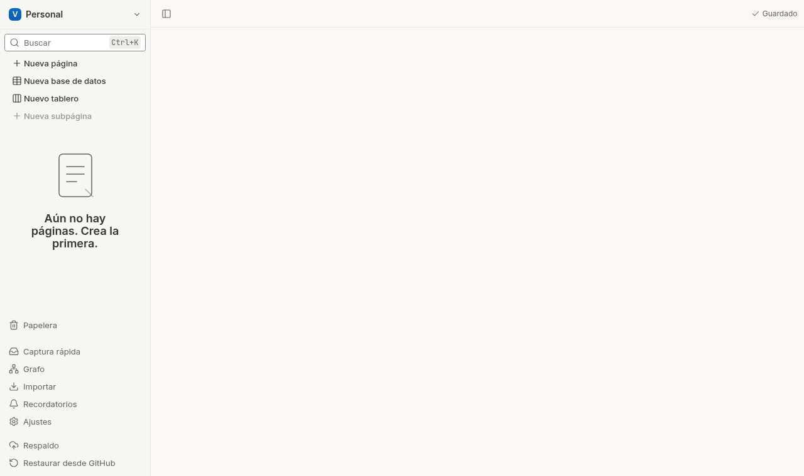

Los accesos de la parte inferior de la barra lateral son: **Papelera**, **Captura rápida**, **Grafo**, **Importar**, **Recordatorios**, **Ajustes**, **Respaldo** y **Restaurar desde GitHub**.

## 2. Espacios de trabajo

Un espacio de trabajo es un cuaderno independiente: tiene sus propias páginas, adjuntos, papelera y configuración de respaldo. La búsqueda y los enlaces **nunca cruzan** de un espacio a otro.

Desde **Espacios de trabajo** (enlace en la parte superior de la barra lateral) puedes:

| Acción | Cómo |
|---|---|
| Crear | Escribe el nombre y pulsa **Crear espacio**. |
| Abrir / cambiar | Pulsa **Abrir «nombre»**. |
| Renombrar | **Renombrar**, escribe el nuevo nombre y confirma. |
| Eliminar | **Eliminar espacio** y escribe el nombre exacto para confirmar. Si no tiene respaldo, se te advierte de forma destacada. |
| 🖥️ Elegir dónde se guarda | Al crear, **Elegir carpeta…** abre el selector del sistema. Una carpeta que ya usa otro espacio se rechaza. |
| 🖥️ Ver la carpeta | **Abrir carpeta** la muestra en el explorador de archivos. |

Si la carpeta de datos no está disponible (por ejemplo un disco externo desconectado), la aplicación lo avisa y **no crea un espacio vacío** en su lugar: conecta el disco y reintenta.

El espacio marcado como **predeterminado** recibe la captura rápida (sección 11).

Si abres el mismo espacio en dos pestañas o ventanas, solo una puede editar; la otra queda en solo lectura con un aviso.

## 3. Páginas y barra lateral

Las páginas se organizan en un **árbol** sin límite de profundidad.

- **Nueva página** crea una página en la raíz; **Nueva subpágina** la crea dentro de la seleccionada.
- **Arrastra** una página en el árbol para moverla con todas sus hijas. Si intentas moverla dentro de sí misma o de una descendiente, la aplicación te lo impide y explica el motivo.
- Una página sin título se muestra como «Sin título».

En la cabecera de cada página:

| Botón | Qué hace |
|---|---|
| Título | Se edita directamente; se guarda al salir del campo o con Enter (Esc descarta). |
| **Añadir ícono** / **Quitar ícono** | Un emoji o carácter junto al título. |
| **Añadir portada** / **Quitar portada** | Franja de color superior. |
| **Marcar como favorita** | Aparece en la sección *Favoritos* de la barra lateral. |
| **Duplicar** | Elige entre solo esta página o con sus hijas; las copias reciben identificadores nuevos. |
| **Exportar** | Ver sección 13. |
| **Eliminar** | Manda la página y sus hijas a la papelera. |

Arriba del título aparecen las **migas de pan** (la ruta de ancestros); pulsa una para subir.

### Papelera

Eliminar **nunca borra de inmediato**: manda la página (con sus hijas) a la **Papelera**, donde se conserva **30 días**. Después se purga sola, incluso si la aplicación estuvo cerrada.

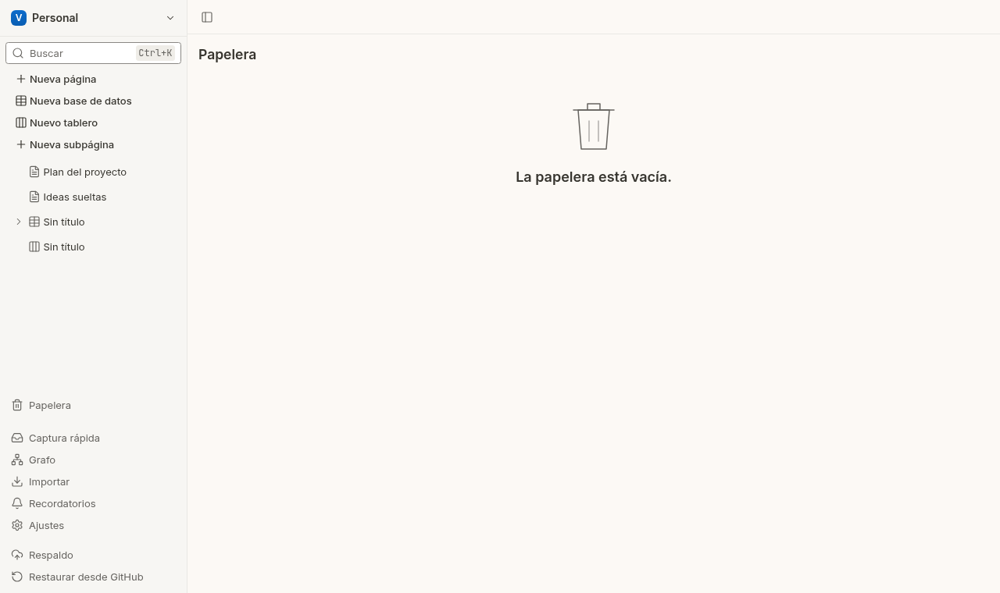

Desde la papelera puedes **Restaurar** (a su lugar, o a la raíz si su padre ya no existe), **Eliminar definitivamente** (pide confirmación) o **Vaciar papelera** (también con confirmación). Cada elemento muestra los días que le quedan.

## 4. El editor de bloques

Cada página es una lista de **bloques**. Todo se guarda solo, sin botón de guardar. Puedes deshacer y rehacer (Ctrl+Z / Ctrl+Shift+Z), incluso al volver a abrir la página.

### Insertar bloques con `/`

En una línea vacía escribe `/` para abrir el menú de bloques y sigue escribiendo para filtrar.

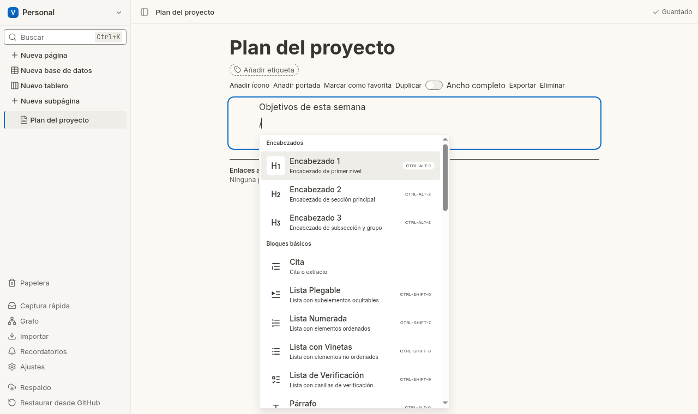

Bloques disponibles: encabezados 1 a 3, párrafo, cita, lista con viñetas, lista numerada, lista de verificación, lista plegable, bloque de código, tabla, imagen, archivo, **aviso destacado**, **divisor**, **desplegable**, **enlace web** (tarjeta), **tarea con fecha**, **vista de base de datos**, **diagrama de flujo**, **mapa mental**, **organigrama**, **línea de tiempo** y **matriz**.

### Atajos de Markdown

| Escribes | Obtienes |
|---|---|
| `#`, `##`, `###` + espacio | Encabezado 1, 2, 3 |
| `-` + espacio | Lista con viñetas |
| `1.` + espacio | Lista numerada |
| `[]` + espacio | Lista de verificación |
| `>` + espacio | Cita |

### Formato de texto

Selecciona texto para ver la barra de formato: negrita, cursiva, subrayado, tachado, código, enlace, **color de texto** y **resaltado**.

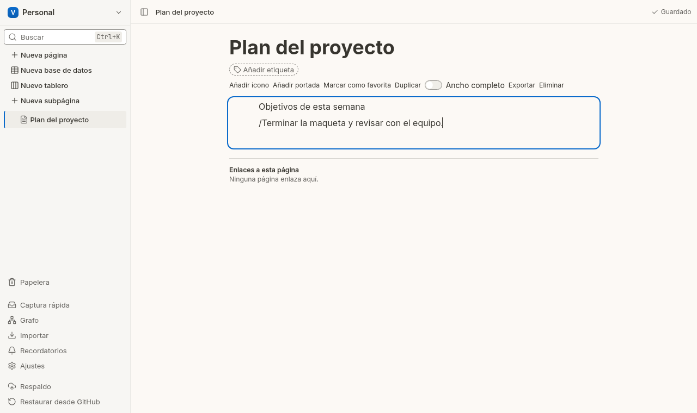

### Imágenes y archivos

Inserta una imagen o un archivo desde el menú `/`, arrastrándolo o pegándolo. Los adjuntos se guardan por contenido: dos archivos con el mismo nombre conviven sin pisarse, y el mismo contenido no se duplica. No hay límite de tamaño, pero un archivo de **más de 100 MB** muestra un aviso: se guarda en tu equipo y **no se incluirá en los respaldos de GitHub**.

### Contenido pegado

Lo que pegas desde otras fuentes se **limpia** (se eliminan scripts y formato inseguro); nunca se ejecuta.

### Páginas muy grandes

Una página funciona con fluidez hasta unos 2 000 bloques. Al pasar de 5 000 aparece un aviso que sugiere dividirla en varias; puedes seguir editando.

## 5. Buscar y la paleta de comandos

Pulsa **Ctrl+K** (o **Ctrl+Shift+F** para buscar) para abrir la paleta. Sin texto muestra tus **páginas recientes**.

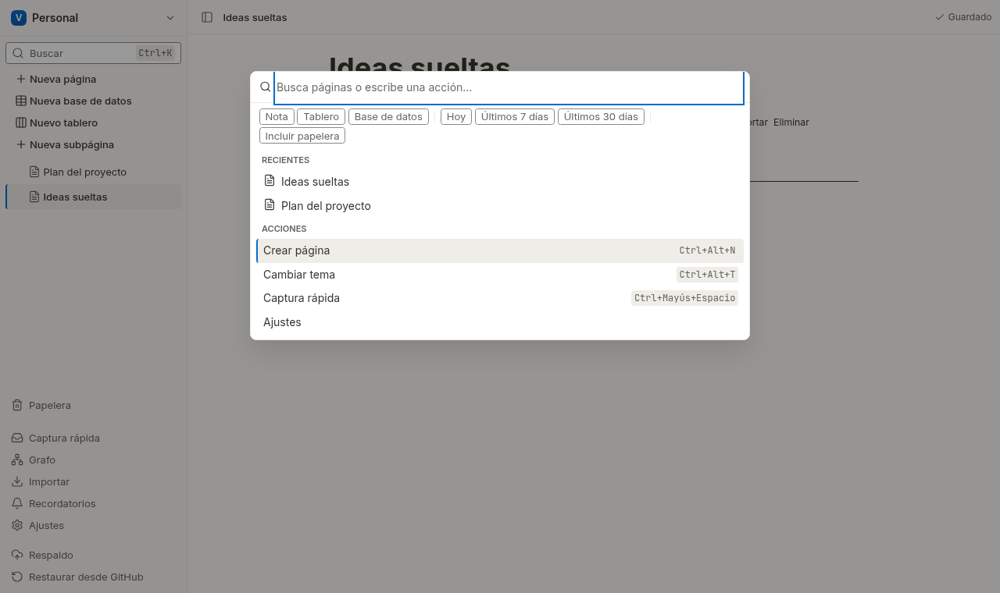

Al escribir busca en vivo por **título y contenido**, resalta la coincidencia y se navega con las flechas y Enter. Si no hay resultados lo indica.

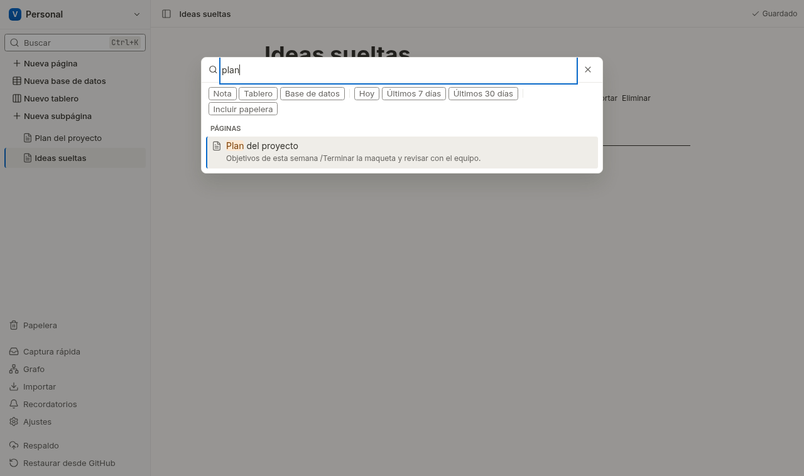

La paleta también ejecuta acciones comunes: **crear página**, **cambiar tema**, abrir ajustes, etc. Puedes filtrar por tipo de página o fecha de modificación e incluir lo que está en la papelera.

## 6. Enlaces entre páginas y grafo

En el editor escribe **`@`** o **`[[`** y el nombre de una página para insertar una **mención** (enlace). Cada página muestra al pie sus **retroenlaces** («Enlaces a esta página»).

- Si la página enlazada se elimina, el enlace se muestra como **roto** con la opción de restaurarla.
- Los enlaces circulares están permitidos.

El **Grafo** (barra lateral) dibuja las páginas y sus enlaces. Puedes limitar el alcance a la página actual y sus vecinas o ver todo el espacio, y filtrar por tipo de página.

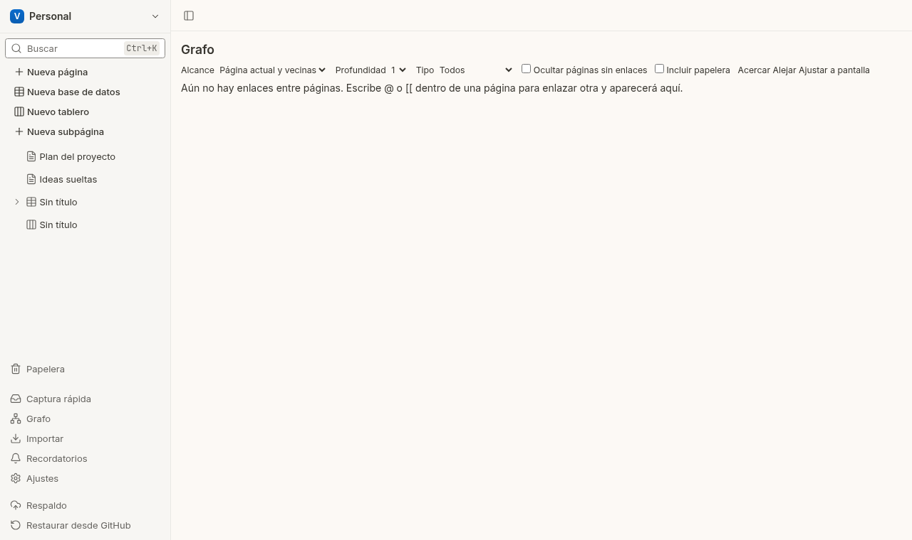

## 7. Bases de datos

Una base de datos es una colección de filas (cada fila es una página completa) con **propiedades**. Se crea con **Nueva base de datos** en la barra lateral, o se inserta dentro de una nota con el bloque **Vista de base de datos**.

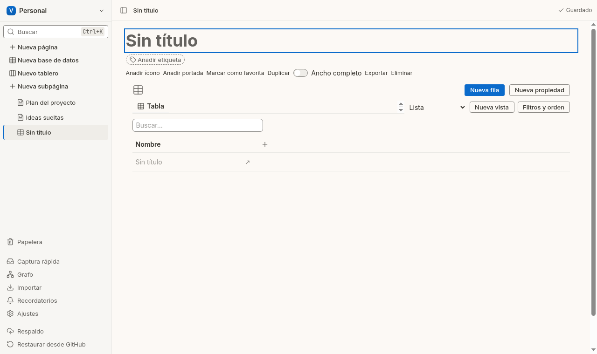

- **Nueva fila** añade una fila; el título se edita en la propia tabla y la fila se abre como página.
- **Nueva propiedad** pide nombre y tipo. Tipos: texto, número, selección, selección múltiple, fecha, casilla, enlace web, correo, teléfono, archivos, estado, fecha de creación, última edición, **relación**, **rollup** y **fórmula**.
- Desde el encabezado de cada propiedad puedes renombrarla o eliminarla.
- Los valores se validan según el tipo (por ejemplo, un número inválido muestra el error y conserva el valor anterior).
- Una página puede pertenecer a **varias bases** con valores independientes. Al eliminarla se te avisa de en cuántas está.

### Vistas

Cada base tiene vistas guardadas, que eliges con las pestañas o **Nueva vista**: **Tabla**, **Lista**, **Galería**, **Calendario** (mes; arrastrar entre días cambia la fecha), **Línea de tiempo** tipo Gantt (arrastrar y redimensionar barras cambia fechas) y **Tablero**. **Filtros y orden** permite filtros por tipo de propiedad con grupos Y/O anidados, orden múltiple y agrupación. Una vista puede enlazarse y mostrarse en otra página.

### Relaciones y rollups

Una **relación** vincula filas de dos bases en ambos sentidos; al eliminar una fila, el vínculo desaparece del otro lado. Un **rollup** resume datos relacionados: contar, sumar, promedio, mínimo o máximo, y se recalcula solo.

### Fórmulas

Una propiedad de tipo **Fórmula** calcula un valor por fila, por ejemplo `prop("Costo") * prop("Cantidad")`. Incluye funciones de texto, números, fechas y lógica. El editor muestra una vista previa y los errores en español; un error en una celda **no afecta a las demás**. Una definición circular (fórmulas, rollups o relaciones que se refieren entre sí) se rechaza con un mensaje.

## 8. Tableros kanban

**Nuevo tablero** crea una base con la propiedad *Estado* y una vista de columnas **Por hacer**, **En curso** y **Hecho**.

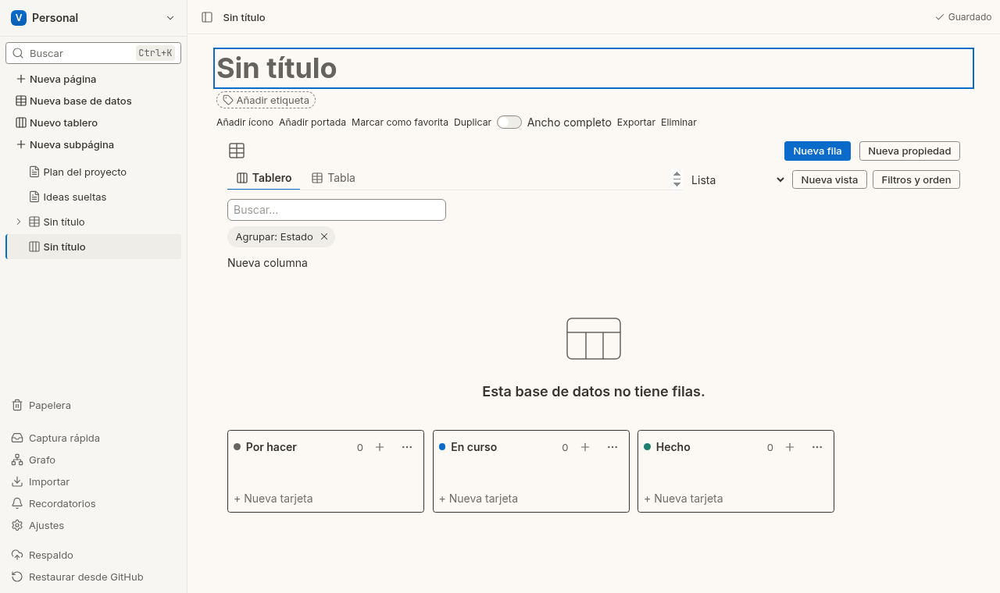

- **+ Nueva tarjeta** (en cada columna) crea una tarjeta, que es una **página completa** con su propio editor.
- **Arrastra** las tarjetas entre columnas o dentro de una; el estado y el orden se guardan.
- **Nueva columna**, y en cada columna los íconos para **renombrar** y **eliminar** (si tiene tarjetas, eliges a qué columna moverlas).
- La tarjeta muestra su fecha límite y un 🔔 si tiene recordatorio.
- Mover una tarjeta en un tablero no cambia su estado en otros tableros donde esté.

## 9. Tareas, recordatorios y agenda

Una **tarea** es una casilla con fecha límite, recordatorio y repetición. Se crea con el bloque **Tarea con fecha** (`/`), y también cuentan las casillas con fecha, las tarjetas y las filas de una base cuya propiedad de fecha esté marcada como tarea.

- **Recordatorio:** fecha y hora de aviso. Si ya pasó, se avisa y se guarda como vencido.
- **Repetición:** cada día, semana, mes o año. Las mensuales y anuales ajustan al fin de mes (un día 31 en febrero cae el 28 o 29). Completar una tarea recurrente programa la siguiente.
- La hora es la **local del equipo**; si cambia la zona horaria, el recordatorio conserva la hora prevista.

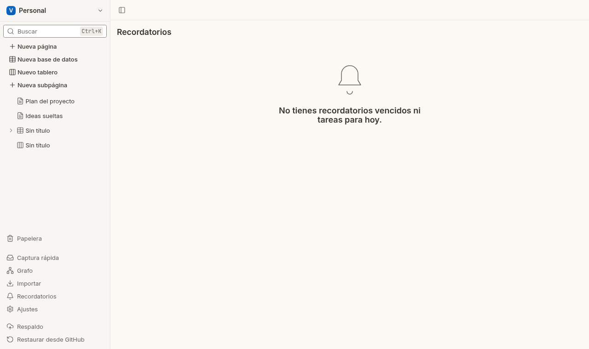

**Recordatorios** muestra el **resumen de todos los espacios**: lo vencido y lo de hoy, con el espacio de origen. Sobre cada elemento: **Abrir**, marcar como **Hecho**, **Posponer** (10 minutos, 1 hora, hasta mañana) o **Descartar**. Al abrir la aplicación, si hay vencidos o tareas de hoy, se muestra este resumen. También hay una **Agenda** por espacio ordenada por fecha.

**Avisos:** cada minuto se revisa lo que venció. Si son muchos a la vez, se agrupan en **una sola notificación**. En el navegador solo avisa con la aplicación abierta. 🖥️ En escritorio, además de la notificación del sistema, aparece una **ventanita** con **Abrir**, **Hecho** y **Posponer** que no te quita el foco de lo que estés haciendo; los recordatorios siguen llegando aunque la ventana principal esté oculta en la bandeja.

## 10. Diagramas y organizadores gráficos

Desde `/` puedes insertar lienzos visuales dentro de una página:

| Bloque | Para qué sirve |
|---|---|
| **Diagrama de flujo** | Formas (inicio/fin, proceso, decisión, entrada/salida, nota) unidas por conectores con texto. |
| **Mapa mental** | Ideas en ramas alrededor de una idea central. |
| **Organigrama** | Niveles de padre a hijo. |
| **Línea de tiempo** | Eventos ordenados por fecha; dos eventos en la misma fecha no se superponen. |
| **Matriz** | Filas y columnas (plantilla 2×2 de importante/urgente). |

### Diagrama de flujo

- **Formas:** elige una de la paleta (o arrástrala al lugar que quieras), **muévela**, **redimensiónala** con los tiradores de sus esquinas y edita su texto.
- **Conectar donde tú quieras:** al seleccionar una forma, pasar el puntero por ella o arrastrar un conector cerca, aparecen sus **8 puntos de unión**. Arrastra desde uno y suéltalo en un punto de otra forma: el conector queda unido **exactamente ahí** y **sigue a ese punto** cuando mueves o cambias de tamaño las formas. Si sueltas en un lugar vacío, el extremo queda **libre** en ese punto; puedes arrastrarlo después a otra forma o despegarlo. Con el teclado, el panel del conector permite elegir la forma y el punto de unión de cada extremo.
- **Trazado del conector:** en su panel elige **Recto**, **Ángulos de 90°** (se calcula solo y puedes arrastrar sus tramos intermedios; «Restablecer ruta» vuelve al cálculo automático), **Redondeado** (arrastra su asa o usa «Curvatura») o **Libre** (puntos de control: arrástralos, añade uno con doble clic o con «Añadir punto», quítalo con Supr; «Suavizado» alterna entre segmentos rectos y curva). Si cambias de trazado se avisa de los ajustes que se descartan y puedes deshacer.
- **Colores y estilo:** cada forma tiene **relleno** (o sin relleno) con **opacidad**, **contorno** (color, grosor y tipo de línea) y **color del texto**; cada conector, **color**, **grosor**, **tipo de línea**, **punta de cada extremo** (flecha, círculo, rombo o ninguna) y color de su texto. Elige de la **paleta** (cambia con el tema claro u oscuro) o escribe un color **hexadecimal**; los colores personalizados se ven igual en ambos temas, y si el texto queda con poco contraste se te avisa sin impedirlo. Los últimos colores usados quedan a la mano.
- **Estilo predeterminado:** «Usar como predeterminado» guarda el estilo de la forma (o del conector, con su trazado) para las nuevas de **ese espacio de trabajo**; «Restablecer predeterminados» vuelve al del sistema. Lo ya dibujado no cambia.
- **Copiar y pegar:** **Copiar** y **Pegar** (Ctrl/Cmd+C y V con el foco en el diagrama) duplican las formas seleccionadas con los conectores que las unen, desplazadas; se puede pegar en otro diagrama mientras la ventana siga abierta. **Copiar formato** y **Pegar formato** (Ctrl/Cmd+Alt+C y V) pasan solo el estilo a otro elemento del mismo tipo. Nada de esto usa el portapapeles del sistema.
- **Vista:** botones **Acercar**, **Alejar** y **Ajustar a pantalla** en una esquina del lienzo, desplazamiento arrastrando el fondo, y **Deshacer/Rehacer** de cada acción.
- **Al eliminar una forma** sus conectores no se pierden: quedan con ese extremo libre y se avisa cuántos son; **Deshacer** los vuelve a unir.

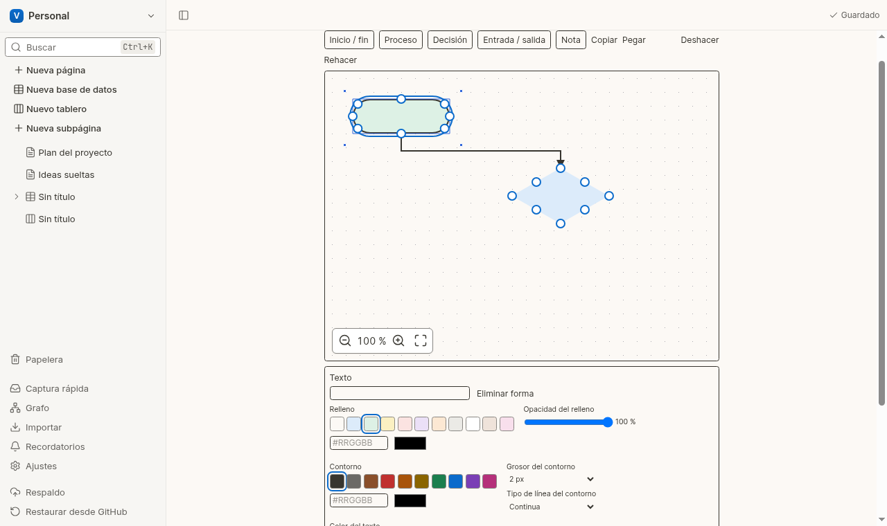

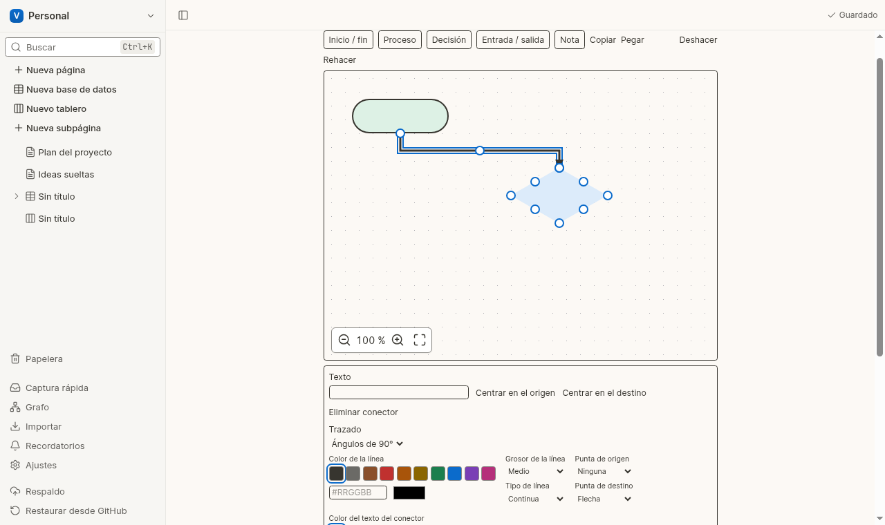

Un diagrama grande (200 formas y 300 conectores) se mueve y amplía con fluidez. Todos se pueden exportar como imagen vectorial dentro de HTML/PDF (sección 13), con los mismos colores, trazados y puntas que ves en el lienzo. Los diagramas guardados con una versión anterior se abren sin cambios de aspecto.

## 11. Captura rápida

Sirve para anotar una idea al instante sin abrir el espacio. Lo escrito se guarda en la **Bandeja de entrada** del **espacio predeterminado** (si la bandeja no existe, se crea sola). Después puedes **mover** la nota a una página o **convertirla en tarjeta**.

- Dentro de la aplicación: **Captura rápida** en la barra lateral o **Ctrl+Shift+Espacio**.
- Si cancelas con texto escrito, se conserva el borrador y se ofrece descartarlo.
- Si el espacio predeterminado se elimina, se te pide elegir otro.
- 🖥️ **Atajo global** (desde cualquier programa): se configura en **Ajustes**. Si tu sistema no lo permite (por ejemplo, algunos entornos Wayland), **Ajustes** lo avisa y muestra la orden `… --capture` para asignar un atajo desde el propio sistema. También se abre desde el icono de la **bandeja del sistema**.

## 12. Importar

**Importar** trae notas de otras herramientas **sin modificar nada de lo que ya tienes**: todo se crea dentro de una página contenedora nueva. Importar dos veces el mismo contenido crea dos contenedores distintos.

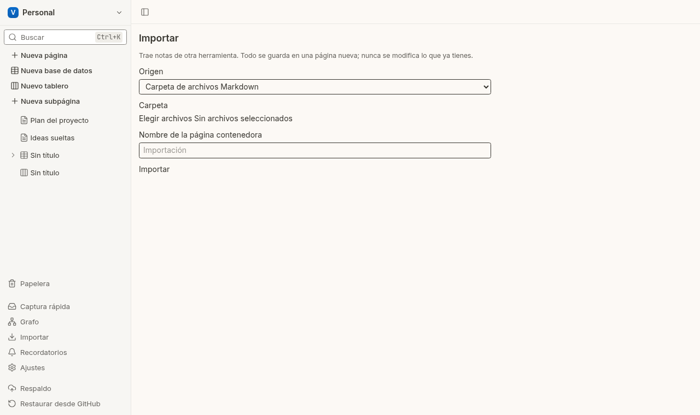

Orígenes: una **carpeta de Markdown**, una **bóveda de Obsidian** (convierte los enlaces `[[ ]]` en menciones y las imágenes locales en adjuntos) y una **exportación de Notion** (ZIP de Markdown y CSV, reconstruyendo la jerarquía; los CSV se convierten en bases de datos básicas).

Se muestra el **progreso** y se puede **cancelar**: la importación es atómica, y cancelar no deja nada a medias. Al terminar ves un **informe** con lo importado, lo aproximado, lo omitido y los enlaces rotos. Un archivo dañado se omite y se reporta, sin detener el resto.

## 13. Exportar a HTML y PDF

En la cabecera de la página, **Exportar** abre el diálogo.

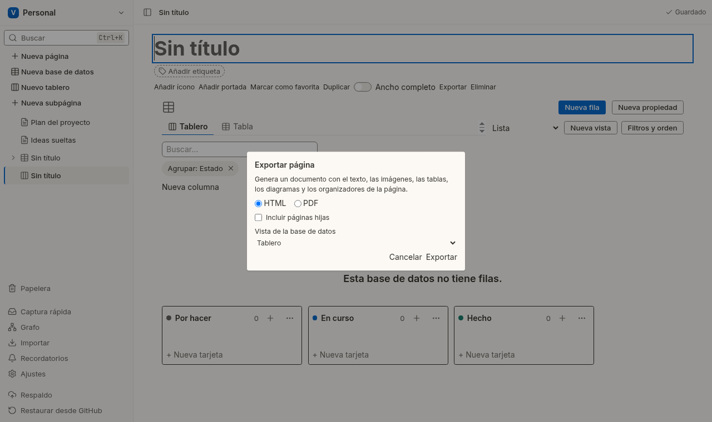

1. Elige **HTML** o **PDF**.
2. Marca **Incluir páginas hijas** si las quieres (el documento lleva un **índice** con enlaces).
3. En una página de base de datos o tablero, elige la **vista** que se exportará.
4. Pulsa **Exportar**. Verás una barra de **progreso** y puedes **Cancelar la exportación** (no se guarda nada a medias).

**HTML:** un solo archivo autocontenido (estilos e imágenes incrustados, sin scripts ni recursos externos). En la web se descarga; 🖥️ en escritorio se guarda en tu carpeta de **Descargas** sin sobrescribir archivos existentes (si el nombre existe, añade « (2)»…) y se muestra la ruta.

**PDF:** se abre el diálogo de impresión del sistema; elige **«Guardar como PDF»** como destino. El documento trae estilos de impresión (cada página hija empieza en hoja nueva).

Incluye texto, listas, tablas, código, imágenes, diagramas y organizadores como vectores, y la vista de base de datos elegida. Si falta algún adjunto, se **completa la exportación** con lo demás y se avisa cuál faltó.

## 14. Respaldo en GitHub y restauración

El respaldo copia tu espacio a un **repositorio privado de GitHub** en Markdown y JSON **sin cifrar**, con una salida determinista: dos respaldos del mismo contenido dan el mismo resultado y **no se crea commit si no hubo cambios**.

> ⚠️ Es lo único que sale de tu equipo. El token **nunca** se guarda en el repositorio, en la base ni en los registros: en escritorio vive en el **llavero del sistema** (si no hay servicio de llavero, se pide en cada sesión); en el navegador, solo en memoria.

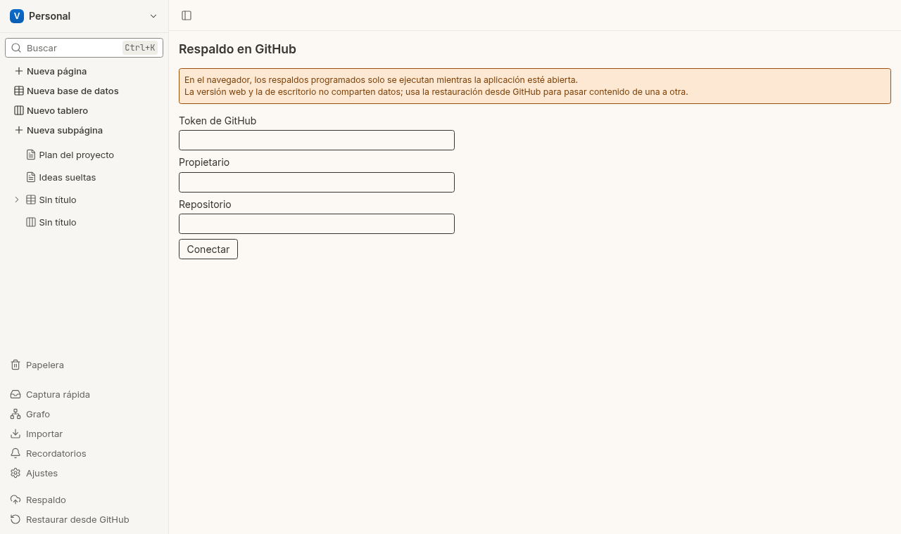

### Configurar

1. En GitHub crea un **repositorio privado** vacío y un **token** con permiso de escritura sobre él.
2. En **Respaldo** escribe el token, el propietario y el repositorio, y pulsa **Conectar**. Si el repositorio es público, se te advierte y debes confirmarlo.
3. Elige la **frecuencia** (de 1 a 7 días; por defecto 1).

Cada espacio tiene su propio repositorio y frecuencia.

### Uso

- **Respaldar ahora** lo fuerza (y sirve también como **Reintentar**).
- El panel muestra el **último respaldo**, el **próximo plazo** y un **historial**.
- Si el plazo venció mientras la aplicación estaba cerrada, al abrirla se hace **un solo** respaldo.
- Ante un fallo se muestra la **causa** (sin internet, token inválido, límite de uso, repositorio lleno…) y se reintenta automáticamente a 1, 5, 15 y 60 minutos antes de avisarte. **Un fallo nunca modifica ni borra tus datos locales.**
- Si alguien escribió en el repositorio por fuera, se te **pregunta** cómo continuar.
- Los adjuntos de más de 100 MB se omiten y se listan.
- En el navegador, los respaldos programados solo corren con la aplicación abierta; en escritorio siguen corriendo con la ventana oculta en la bandeja.

### Restaurar

**Restaurar desde GitHub** (también en el primer inicio de un equipo nuevo) te guía en tres pasos: conectar, **elegir un respaldo** por fecha y elegir el destino.

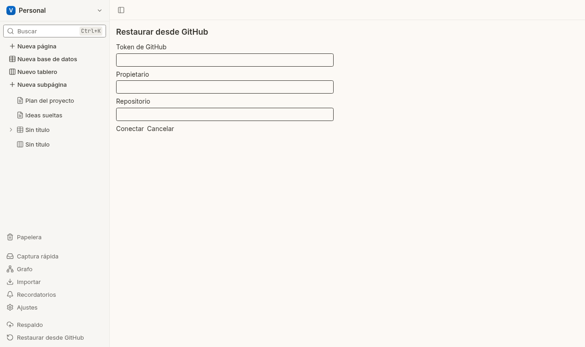

- **Como espacio nuevo:** crea un espacio con el contenido del respaldo, sin tocar nada existente.
- **Reemplazar un espacio:** muestra qué se sustituirá y pide confirmación; si cancelas, todo queda intacto.
- Un respaldo hecho con una **versión futura** de la aplicación o con contenido dañado se rechaza sin modificar nada.

La versión web y la de escritorio **no comparten datos**; usa respaldo y restauración para pasar contenido de una a otra.

## 15. Ajustes: tema, idioma y atajos

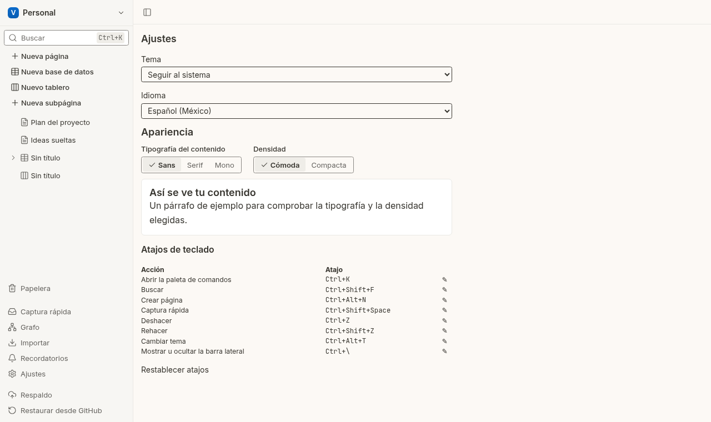

- **Tema:** claro, oscuro o seguir al sistema.
- **Idioma:** español (México) o inglés; cambia al instante.
- **Atajos de teclado:** cada acción tiene un atajo que puedes **reasignar**: pulsa «Cambiar atajo», escribe la nueva combinación (Esc cancela). Si ya lo usa otra acción, se avisa y eliges quién lo conserva. **Restablecer atajos** vuelve a los de fábrica.

| Acción | Atajo por defecto |
|---|---|
| Abrir la paleta de comandos | Ctrl+K |
| Buscar | Ctrl+Shift+F |
| Crear página | Ctrl+Alt+N |
| Captura rápida | Ctrl+Shift+Espacio |
| Deshacer / Rehacer | Ctrl+Z / Ctrl+Shift+Z |
| Cambiar tema | Ctrl+Alt+T |
| Mostrar u ocultar la barra lateral | Ctrl+\ |

(En macOS, Ctrl se corresponde con ⌘.)

**Accesibilidad:** se puede usar todo con el teclado (hay un enlace «Saltar al contenido»), los controles tienen etiquetas para lectores de pantalla y el contraste cumple el nivel AA.

## 16. Versión de escritorio

Además de todo lo anterior, la aplicación de escritorio:

- Guarda los datos en la **carpeta estándar de tu sistema** (Linux: `~/.local/share/dev.vnote.app`; macOS: `~/Library/Application Support/dev.vnote.app`; Windows: `%APPDATA%\dev.vnote.app`), y por espacio puedes elegir otra carpeta.
- Al **cerrar la ventana** se oculta a la **bandeja del sistema** (menú: Abrir, Captura rápida, Salir) y sigue avisando recordatorios y haciendo respaldos. Para terminarla del todo usa **Salir**.
- Solo permite **una instancia**: abrirla de nuevo enfoca la ventana existente.
- Guarda el token de GitHub en el **llavero del sistema**.
- Avisa cuando hay una **versión nueva** (con botón **Descargar**, que abre la página de la versión; la actualización es manual). El aviso requiere configurar `updateRepo` en `brand.config.json`.
- Genera instaladores (`.deb`, AppImage, `.msi`) con `bun run tauri build` o el workflow `package`.

La versión web se puede **instalar como PWA** desde el navegador y arranca sin conexión.

## 17. Preguntas frecuentes

**¿Dónde están mis datos?** En una base SQLite local por espacio (carpeta de datos en escritorio; almacenamiento del navegador en la web). Nada sale de tu equipo salvo el respaldo a GitHub si lo activas.

**¿Se pierde algo si se va la luz mientras escribo?** No se corrompen las páginas; como máximo se pierde el último cambio en curso.

**Eliminé una página por error.** Está en la **Papelera** durante 30 días: **Restaurar**.

**El editor dice que no puede guardar.** Se reintenta automáticamente; si el disco está lleno se avisa de inmediato y lo ya guardado no se pierde.

**¿Puedo usar v-note en dos equipos a la vez?** No hay sincronización. Usa respaldo en uno y **Restaurar** en el otro.

**Regenerar las capturas de este manual:**

```bash
CHROME_BIN=/ruta/a/chrome bun docs/manual/capture.ts
```
